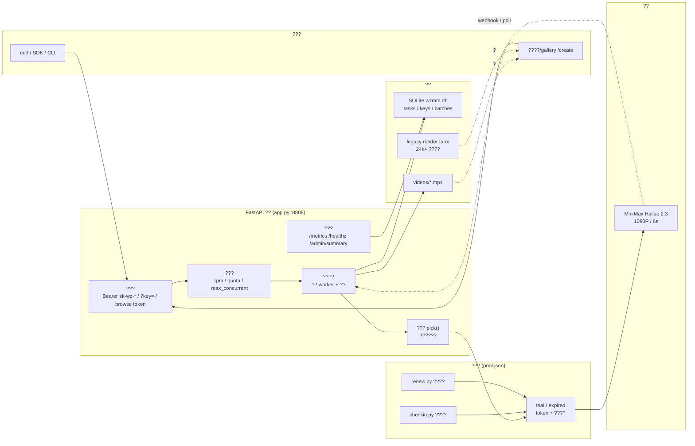
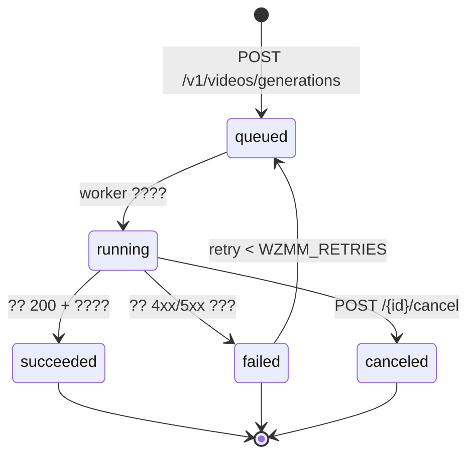

<div align="center">

# MiniMax Video Gateway

**? MiniMax / Hailuo ?????????? OpenAI ??? HTTP API + ??? SDK + ?????**

Account pool ? API keys ? Batching ? Async jobs ? SSE progress ? Webhooks ? Library & gallery ? Ops console

</div>

---

## ????

`minimax-video-gateway` ??? **??????????? FastAPI?** ?????????????
MiniMax?Hailuo 2.3????????????????????????? HTTP ???

- ???????? `sk-wz-...` ? key???? **OpenAI ??** ??????
- ?????????**???**?token ?????????????402 ?????????
- ????????? **?? / SSE / Webhook ??** ????????
- ?? **????**?**??????**?**??????** ? **??????** ?????
- ???? **????????** ? Python SDK/CLI?`sdk/wzmm.py`?????? 53+ ????

??????? `app.py`?? 290 KB?+ ?????? + ?????????????????????

> ?? ????**??????**????????????????? / ????? / ?????? / ???????
> ???????????????????????????????

---

## ??

- [????](#????)
- [??](#??)
- [????](#????)
- [????](#????)
- [???](#???)
- [????](#????)
- [API ??](#api-??)
- [SDK / CLI](#sdk--cli)
- [Web ??](#web-??)
- [????](#????)
- [??](#??)
- [?????????](#?????????)
- [???????](#???????)
- [English Overview](#english-overview)
- [License](#license)

---

## ????

### 1. ??????Account Pool?

| ?? | ?? |
|---|---|
| ???? | `pool.json` ???? + token + ???? + ?? |
| ???? | `renew.py` ???????? token??????? |
| ???? | `checkin.py` ????????????? + ???? |
| 402 ?? | ??????????????????`WZMM_402_COOLDOWN_H`??????? |
| ???? | `pick()` ??????????????????? |
| ????? | `WZMM_EXPIRED_CAP` ??????????? |
| ???? | `/admin/apply-liveness` ??????????? |

### 2. ?????Async Jobs?

- `POST /v1/videos/generations` ???? `vid_...`????????
- ????????
  - **??** `GET /v1/videos/{id}/status`
  - **SSE** `GET /v1/videos/{id}/events`?????????? `event: status|done`?
  - **Webhook** ? `t=<ts>,v1=<hmac>` ??????????????
- ????? `idempotency_key` ????????????
- ???`POST /v1/videos/{id}/cancel`????????
- ???`POST /v1/videos/{id}/release` ????????????????????

### 3. ?????

- `POST /v1/videos/batch` ?? ???? 64 ???????
- `POST /v1/videos/bulk` ?? ?? `dry_run` ?????
- ?????`GET /v1/videos/archive?batch_id=...` ?? zip?
- ?????`GET /v1/videos/generations?limit=...&cursor=...`?

### 4. ???

- `POST /admin/keys` ? key?`rpm` / `quota` / `max_concurrent` / `disabled`??
- `PATCH /admin/keys/{kid}` ??????
- `DELETE /admin/keys/{kid}?hard=1` ?????????? 409??
- ?????? rpm?????????????
- ?? key ????? usage ???`GET /v1/usage?days=7`??

### 5. ??

- `GET /healthz` ?? ? `canary` ??????
- `GET /metrics` ?? Prometheus ??????????????webhook???????
- `GET /admin/summary` ?? ??????? / ?? / ?? / ?? / Top ?? / `latency_24h`?
- `GET /admin/verify` + `POST /admin/verify` ?? ???????

### 6. ????

- `/videos` ??????????????
- `/opt/h3v2/data/render/out`?`WZMM_LEGACY`??????????????
- ????? ffmpeg ??????
- `GET /v1/library` ?? `res=1080p` ???`embed_key=1` ??? key?
- `GET /v1/library/manifest?format=csv|txt` ??? `wget -i` ????

---

## ??



**??????**



---

## ????

```
minimax-video-gateway/
?? app.py                  # ??????97 ????55 admin / 33 v1 / 9 ???
?? sdk/
?  ?? wzmm.py              # ??? SDK + CLI??????53 ????
?? docs/
?  ?? API_QUICKSTART.md    # ??????????????????
?  ?? ENDPOINTS.md         # 55 ??????????
?  ?? COVERAGE.md          # 62 ????????0 ? 5xx?
?? tests/                  # 14 ????? / 301 ???
?  ?? _wz_402.py           # 402 ?????
?  ?? _wz_api_matrix.py    # ????
?  ?? _wz_archive_job.py   # ????
?  ?? _wz_browse.py        # ??????
?  ?? _wz_browse_rotate.py # ????
?  ?? _wz_capacity.py      # ????
?  ?? _wz_create.py        # ??????
?  ?? _wz_envelope.py      # ?????
?  ?? _wz_h3gate.py        # ?????
?  ?? _wz_pick.py          # ????
?  ?? _wz_producer.py      # ????
?  ?? _wz_proxy.py         # ????
?  ?? _wz_sdk.py           # SDK ??
?  ?? _wz_watch.py         # ???
?? producer.sh             # ????????
?? renew.py                # ????
?? checkin.py              # ????
?? sync_pool.py            # ???? + ???
?? proxy_relay.py          # ???? CONNECT ???? Chrome ??
?? _r710_up.py             # ?????? + ? token
?? requirements.txt
?? .env.example
?? .gitignore
?? LICENSE
?? README.md
```

---

## ????

### 1. ??

```bash
git clone https://github.com/Potato-Allens/minimax-video-gateway.git
cd minimax-video-gateway

python3.12 -m venv venv
./venv/bin/pip install -r requirements.txt
```

`requirements.txt`

```
fastapi>=0.110
uvicorn>=0.27
pydantic>=2.0
requests>=2.31
curl_cffi>=0.7        # ?? TLS ??
playwright>=1.40      # ???/??????
```

### 2. ????

```bash
cp .env.example .env
# ????WZMM_ADMIN_KEY / WZMM_POOL / WZMM_VIDEOS
```

### 3. ?????

`pool.json` ???????????????

```json
{
  "accounts": [
    {
      "email": "account@example.com",
      "token": "<upstream-token>",
      "exp": 1790000000,
      "kind": "trial",
      "disabled": false
    }
  ]
}
```

> ??**???????**?`pool.json`?`accounts_sso.jsonl`?`wzmm.db`?`videos/` ??? `.gitignore` ??

### 4. ??

```bash
export WZMM_ADMIN_KEY="$(openssl rand -hex 24)"
./venv/bin/uvicorn app:app --host 0.0.0.0 --port 8808
```

?? <http://127.0.0.1:8808/docs> ? OpenAPI?

### 5. ??? key ???

```bash
ADMIN="<?? admin token>"
BASE="http://127.0.0.1:8808"

KEY=$(curl -s -X POST "$BASE/admin/keys" \
  -H "X-Admin-Token: $ADMIN" \
  -H "Content-Type: application/json" \
  -d '{"name":"demo","rpm":120}' | python -c 'import sys,json;print(json.load(sys.stdin)["key"])')

# ????????????
curl -s -X POST "$BASE/v1/videos/generations" \
  -H "Authorization: Bearer $KEY" -H "Content-Type: application/json" \
  -d '{"prompt":"a lantern over a lake, slow dolly-in","dry_run":true}'

# ???
VID=$(curl -s -X POST "$BASE/v1/videos/generations" \
  -H "Authorization: Bearer $KEY" -H "Content-Type: application/json" \
  -d '{"prompt":"a lantern over a lake, slow dolly-in","resolution":"1080P","duration":6}' \
  | python -c 'import sys,json;print(json.load(sys.stdin)["id"])')

# ??
curl -s "$BASE/v1/videos/$VID/status" -H "Authorization: Bearer $KEY"

# ??
curl -L -o out.mp4 "$BASE/v1/videos/$VID/content?key=$KEY"
```

---

## ???

?????????????????

| ?? | ?? | ?? |
|---|---|---|
| `WZMM_PORT` | `8808` | ???? |
| `WZMM_ADMIN_KEY` | ? | ??? token?`X-Admin-Token`??**????** |
| `WZMM_POOL` | `/opt/wzmm/pool.json` | ????? |
| `WZMM_DB` | `/opt/wzmm/wzmm.db` | SQLite ??? |
| `WZMM_VIDEOS` | `/opt/wzmm/videos` | ???? |
| `WZMM_LEGACY` | `/opt/h3v2/data/render/out` | ???????? |
| `WZMM_ONLY_1080P` | `1` | ??? 1080P???????? 400 |
| `WZMM_COST_1080` | `80` | ?? 1080P/6s ????? |
| `WZMM_MAX_INFLIGHT` | ?? | ????????? |
| `WZMM_EXPIRED_CAP` | ? | ???????? |
| `WZMM_DEAD` | ? | ????????? |
| `WZMM_402_COOLDOWN_H` | ? | 402 ??????? |
| `WZMM_TTL_DAYS` | ? | ?????? |
| `WZMM_GC_WARN_GB` / `WZMM_DISK_SOFT_GB` / `WZMM_MIN_FREE_GB` / `WZMM_MIN_ACCEPT_GB` | ? | ????????? |
| `WZMM_GC_MIN_AGE_H` / `WZMM_GC_KEEP_NEWEST` | ? | GC ???? |
| `WZMM_WEBHOOK_SECRET` / `WZMM_WEBHOOK_SECRET_FILE` | ? | Webhook ???? |
| `WZMM_HOOKQ` | ? | Webhook ?????? |
| `WZMM_BROWSE_STATE` / `WZMM_BROWSE_TTL_MAX_H` | ? | ???????? |
| `WZMM_CHECKIN_SCRIPT` / `WZMM_CHECKIN_LAST` | ? | ??????? |
| `WZMM_ALERT_WEBHOOK` / `WZMM_ALERT_LOG` | ? | ???? |
| `WZMM_CORS` | ? | CORS ??? |
| `WZMM_H3_REQUIRE_CREDITS` | ? | ????????? |
| `WZMM_PUBLIC_PROBE` / `WZMM_THUMB_JSON` / `WZMM_FARM_STATS` / `WZMM_DISK_HIST` / `WZMM_RUNNER_HB` / `WZMM_POOL_GROWTH_JSON` | ? | ?????? |

---

## ????

| ? | ?? | ?? |
|---|---|---|
| ??? `/v1/*` | `Authorization: Bearer sk-wz-...` ? `?key=` | `?key=` ??? `<video src>` / `wget` ?? |
| ??? `/admin/*` | `X-Admin-Token: <token>` | token ??? `?token=` ?? `/admin/ui` |
| ?? `/gallery` `/library` | `?key=sk-wz-...` ? Bearer | ????? |
| ???? | `?browse=bw_<kid>_<exp>.<mac>` | ???? key ????**???**?????? |
| ?? | `/healthz` `/play` `/docs` `/openapi.json` `/sdk/wzmm.py` | ???? |

??????? `GET /admin/browse-token?ttl_h=168` ???`POST /admin/browse-rotate` ??????? kid?
`GET /admin/browse-audit` ?????????

---

## API ??

????? [`docs/ENDPOINTS.md`](docs/ENDPOINTS.md)?????? [`docs/COVERAGE.md`](docs/COVERAGE.md)?

### ??? `/v1`?33 ??

| ?? | ?? | ?? |
|---|---|---|
| GET | `/v1/models` | ??????? |
| GET | `/v1/pricing` | ?????/????? |
| GET | `/v1/tools` | ?????? |
| POST | `/v1/tools/call` | ???????????? |
| POST | `/v1/videos/generations` | ??????? `dry_run`? |
| GET | `/v1/videos/generations` | ?????????? |
| GET | `/v1/videos/generations/{tid}` | ???? |
| GET | `/v1/videos/{tid}/status` | ???? |
| GET | `/v1/videos/{tid}/meta` | ffprobe ??????/??/??? |
| GET | `/v1/videos/{tid}/thumb` | ???????? |
| GET | `/v1/videos/{tid}/events` | SSE ??? |
| GET | `/v1/videos/{tid}/content` | ?? mp4??? HEAD / Range? |
| POST | `/v1/videos/{tid}/cancel` | ?? |
| POST | `/v1/videos/{tid}/pin` / DELETE | ???? / ???? |
| POST | `/v1/videos/{tid}/release` | ?????? ? ????? |
| POST | `/v1/videos/batch` | ??????64/??????? |
| GET | `/v1/videos/batch/{batch_id}` | ???? + ETA |
| POST | `/v1/videos/batch/{batch_id}/cancel` | ???? |
| POST | `/v1/videos/bulk` | ???????? `dry_run`? |
| GET | `/v1/videos/archive?batch_id=` | ???? |
| POST | `/v1/videos/archive` | ? ids ?? |
| GET | `/v1/library` | ??????`res=` / `embed_key=1`? |
| GET | `/v1/library/stats` | ????? + ????? |
| GET | `/v1/library/manifest` | ?? csv/txt ?? |
| GET | `/v1/library/{fid}/meta` | ????? |
| GET | `/v1/library/{fid}/content` | ???? |
| POST | `/v1/library/archive` | ???? |
| GET/POST/DELETE | `/v1/webhook/secret` | Webhook ?? |
| POST | `/v1/webhook/test` | ???? |
| GET | `/v1/usage?days=` | ? key ?? |
| POST/GET | `/v1/archive/jobs` | ?????? |
| GET | `/v1/archive/jobs/{jid}` / `/file` | ???? / ?? |

### ??? `/admin`?55 ?????

| ?? | ?? |
|---|---|
| Key | `GET/POST /admin/keys`?`PATCH/DELETE /admin/keys/{kid}`?`GET /admin/keys/stale`?`GET /admin/ui?token=` |
| ?? | `GET /admin/pool`?`POST /admin/reload-pool`?`POST /admin/revive`?`POST /admin/park`?`POST /admin/unpark`?`POST /admin/merge-tokens` |
| ?? | `GET /admin/credits`?`GET /admin/token-age`?`GET/POST /admin/checkin`?`POST /admin/simulate-402` |
| ?? | `GET /admin/health`?`/admin/stats`?`/admin/summary`?`/admin/usage`?`/admin/tasks`?`/admin/alerts` |
| ?? | `GET /admin/capacity`?`/admin/capacity/plan`?`/admin/plan`?`/admin/preflight`?`/admin/preflight/matrix` |
| ?? | `GET /admin/retention`?`/admin/gc/preview`?`POST /admin/library/gc`?`GET /admin/orphans`?`POST /admin/orphans/import` |
| ?? | `GET/POST /admin/verify`?`POST /admin/verify/report`?`POST /admin/apply-liveness` |
| Webhook | `GET /admin/webhook`?`/admin/webhook/queue`?`POST /admin/webhook/rotate` |
| ?? | `GET /admin/runner`?`POST /admin/thumbs/prewarm`?`GET /admin/thumbs`?`GET /admin/public`?`POST /admin/public/run`?`POST /admin/alert` |

### ???9 ??

`/healthz` ? `/gallery` ? `/library` ? `/watch/{tid}` ? `/watch/lib/{fid}` ? `/play` ? `/sdk/wzmm.py` ? `/metrics` ? `/create`

---

## SDK / CLI

`sdk/wzmm.py` ????????????????????????? CLI?

```bash
export WZMM_BASE="http://127.0.0.1:8808"
export WZMM_KEY="sk-wz-..."
export WZMM_ADMIN="<admin token>"     # ?? /admin/* ?

python sdk/wzmm.py models
python sdk/wzmm.py submit "a lantern over a lake, slow dolly-in" -o out.mp4
python sdk/wzmm.py batch prompts.txt --concurrency 24 --outdir out/
python sdk/wzmm.py bulk items.json --dry-run
python sdk/wzmm.py library --res 1080p --limit 5
python sdk/wzmm.py manifest --res 1080p --format csv -o lib.csv
python sdk/wzmm.py libarchive --ids t-aaa,t-bbb -o legacy.zip
python sdk/wzmm.py job --kind library --ids t-aaa -o job.zip
python sdk/wzmm.py api GET /v1/pricing
WZMM_ADMIN=... python sdk/wzmm.py admin-health
```

Python ?????

```python
import sys; sys.path.insert(0, "sdk")
import wzmm

wzmm.BASE = "http://127.0.0.1:8808"
wzmm.KEY  = "sk-wz-..."
vid = wzmm.submit("a lantern over a lake", resolution="1080P", duration=6)
wzmm.wait(vid)
wzmm.download(vid, "out.mp4")
```

SDK ???4 ????????429/5xx/????????????????`--json` ???????

---

## Web ??

| ?? | ?? |
|---|---|
| `/create` | **??????**?? prompt ? ???/?? ? ???????? + ???? |
| `/gallery` | ???????????? `res` ?????????? browse ?????? |
| `/library` | ???????2.4 ???????????/???? |
| `/watch/{tid}` `/watch/lib/{fid}` | ?????????/??? |
| `/play` | ??????????????? |
| `/admin/ui?token=` | Key ????? key / ? rpm / ?? / ?? |
| `/docs` | Swagger UI |

---

## ????

| ?? | ?? |
|---|---|
| `producer.sh` | ????????????? Chromium?????? `sync_pool` + `checkin` |
| `renew.py` | ??????? token??????? |
| `checkin.py` | ?????????? dry-run?`--write` ???????? + ??? |
| `sync_pool.py` | `accounts_sso.jsonl` ? `pool.json` ???????????? |
| `proxy_relay.py` | ?? `CONNECT` ???????????? Chrome ?? `Proxy-Authorization`?????? sticky session |
| `_r710_up.py` | ???????? + ? token?Playwright? |

> ??????????????????`PX_USER` / `PX_PASS` / `PX_TMPL` / `PX_SID` / `WZMM_POOL`?
> ???**???????????????????**?

---

## ??

14 ??????? **301 ???**????

```
tests/_wz_402.py           402 ?? ? ?? ? ??
tests/_wz_api_matrix.py    58 ?????
tests/_wz_archive_job.py   ??????
tests/_wz_browse.py        ?????????? 401?
tests/_wz_browse_rotate.py ????
tests/_wz_capacity.py      ????
tests/_wz_create.py        /create ???
tests/_wz_envelope.py      ?????
tests/_wz_h3gate.py        ?????
tests/_wz_pick.py          ??????
tests/_wz_producer.py      ?????
tests/_wz_proxy.py         ??????
tests/_wz_sdk.py           SDK ??
tests/_wz_watch.py         ???
```

????????????????? + ?? key??

```bash
export WZMM_BASE="http://127.0.0.1:8808"
export WZMM_KEY="sk-wz-..."
export WZMM_ADMIN="<admin token>"

python tests/_wz_api_matrix.py
python tests/_wz_sdk.py
# ...
```

????????? `PASS/FAIL` ??? `N/N passed`?

---

## ?????????

1. **?????? `if __name__ == "__main__":` ???**
   ??????????????? `uvicorn.run()` ??????????????? 404 ?????"?"?

2. **?????Chrome ? `--proxy-server` ???????**
   ???????? `CONNECT` ???`proxy_relay.py`??????? `Proxy-Authorization`?
   ????? sticky session id??????????? IP ???

3. **??????? rpm?**
   ?? `GET /v1/videos/{id}/status` ?????????????????????????????

4. **`quota` ??"????"??????**
   ????????? quota ???

5. **????????**
   ?????401/402?????????????? 45 ?????

6. **?????????**
   `WZMM_MIN_ACCEPT_GB` ?????????????? 507????????? SQLite ???

7. **GC ???????**
   `WZMM_GC_MIN_AGE_H`???????+ `WZMM_GC_KEEP_NEWEST`?? N ??+ `pin`???????
   ?????????

8. **SSE ?????**
   ??????????????????????????? sleep?

9. **????? `idempotency_key` + ????**?????????

10. **??????"???"???"??"?**
    ???????????????????????200 ?????? 21.9 ?? 31.9 ?/??

---

## ???????

?????????????????

- **???? API key?`sk-wz-*`?** ? ??? `sk-wz-REPLACE_WITH_YOUR_KEY`?
- **Admin token** ? `<ADMIN_TOKEN>`?
- **??? IP ?????** ? `127.0.0.1` / `api.example.com`?
- **??????????** ? ???? `PX_USER` / `PX_PASS` / `PX_TMPL`????? `user000000-region-XX-...` / `REPLACE_ME`?
- **??????** ? `bw_9999999999.deadbeef`???????????
- **????** ? `[redacted]@example.com`?
- **SSH ???TOTP ??????** ? ????????????
- **?????**?`pool.json` / `accounts_sso.jsonl` / `wzmm.db` / `videos/` / `admin.key` / `*.bak*`?? ?? `.gitignore`?

?????? key ??? `WZMM_KEY` ???????????

??? fork ????????????????????**??**? `pool.json`?`admin.key`?`.env` ??????

> ???????????????????????????????????????????
> ??????????????????????????????????

---

## English Overview

**MiniMax Video Gateway** is a single-process FastAPI gateway that turns an upstream
text-to-video service (Hailuo 2.3) into an OpenAI-style HTTP API.

Highlights:

- **97 routes** ? 55 admin, 33 `/v1`, 9 HTML/JSON pages.
- **Account pool** with token renewal, daily check-in, 402 cooldown, liveness probing and
  in-flight-aware scheduling.
- **Async jobs** with polling, SSE streaming, and HMAC-signed webhooks with a persistent retry queue.
- **Batch pipeline** ? up to 64 prompts per request, auto-chunking, dry-run cost estimation,
  zip archive downloads, and cursor pagination.
- **Multi-tenant keys** ? per-key RPM, quota, max concurrency, usage stats, soft/hard delete.
- **Asset library** ? gallery, prompt studio, legacy render-farm browser, ffprobe metadata,
  cached thumbnails, `csv`/`txt` manifests.
- **Ops surface** ? `/healthz` with canary, Prometheus `/metrics`, one-screen `/admin/summary`,
  capacity planner, disk watermarks, GC preview, full verification harness.
- **Single-file SDK/CLI** (`sdk/wzmm.py`) ? stdlib only, 53 subcommands, 4-step backoff retry.
- **14 regression scripts / 301 assertions.**

Quick start:

```bash
python3.12 -m venv venv && ./venv/bin/pip install -r requirements.txt
cp .env.example .env      # set WZMM_ADMIN_KEY at minimum
./venv/bin/uvicorn app:app --host 0.0.0.0 --port 8808
```

```bash
curl -X POST http://127.0.0.1:8808/v1/videos/generations \
  -H "Authorization: Bearer $WZMM_KEY" -H "Content-Type: application/json" \
  -d '{"prompt":"a lantern over a lake, slow dolly-in","resolution":"1080P","duration":6}'
```

All credentials, proxy endpoints, server addresses and runtime data have been redacted.
No accounts, quotas or proxy service are included. For research and study only.

---

## License

MIT ? 2026 Potato-Allens

? [LICENSE](LICENSE)?
